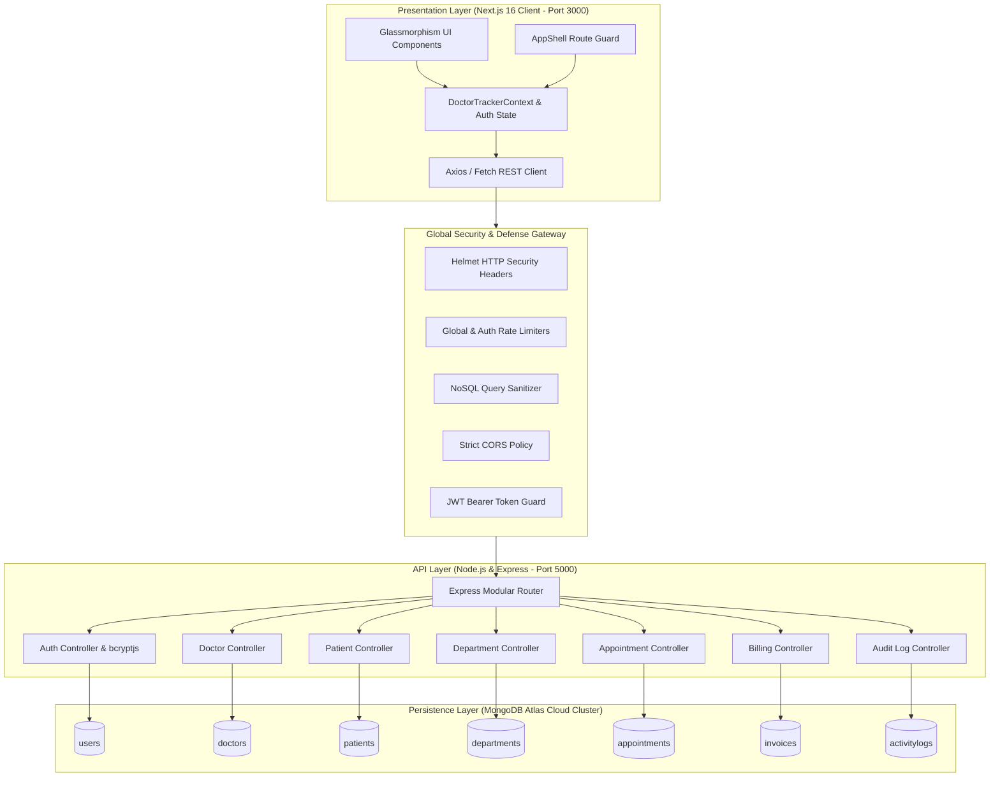

# 🩺 Doctor Tracker — Healthcare Management Admin Portal

> **Production-Grade Clinical Operations & Medical Administration System**  
> *Engineered with Next.js 16 (App Router), TypeScript, Node.js, Express, MongoDB Atlas Cloud, and Modern Vanilla CSS tokens.*

[](https://nextjs.org/)
[](https://www.typescriptlang.org/)
[](https://nodejs.org/)
[](https://expressjs.com/)
[](https://www.mongodb.com/atlas)
[](https://owasp.org/)

---

## 📑 Table of Contents
1. [Description](#1-description)
2. [Setup Guide](#2-setup-guide)
   - [Prerequisites](#prerequisites)
   - [Environment Configuration (.env.example)](#environment-configuration-envexample)
   - [Step-by-Step Installation](#step-by-step-installation)
   - [Demo Administrator Credentials](#demo-administrator-credentials)
3. [System Architecture](#3-system-architecture)
   - [Architecture Diagram](#architecture-diagram)
   - [Data Flow & Service Interactions](#data-flow--service-interactions)
4. [Technical Decisions](#4-technical-decisions)
   - [Decision 1: React Context API with Optimistic UI & Server Sync vs. Redux Toolkit](#decision-1-react-context-api-with-optimistic-ui--server-sync-vs-redux-toolkit)
   - [Decision 2: Node.js + Express with MongoDB Atlas Compound Indexing vs. Relational SQL](#decision-2-nodejs--express-with-mongodb-atlas-compound-indexing-vs-relational-sql)
5. [Global Security & Hardening Suite](#5-global-security--hardening-suite)
6. [Visual Evidence](#6-visual-evidence)
   - [Desktop Layout & UI Components](#desktop-layout--ui-components)
   - [Mobile Responsive Layout](#mobile-responsive-layout)
7. [REST API Endpoints Specification](#7-rest-api-endpoints-specification)

---

## 1. Description

**Doctor Tracker** is a secure, high-performance administrative healthcare web application built for clinical operations managers, medical supervisors, and hospital administrators. The system centralizes specialist physician management, patient medical records, multi-departmental quota tracking, outpatient appointment scheduling, and itemized billing workflows into a unified, responsive dashboard. Featuring live MongoDB Atlas cloud synchronization, sub-second aggregation queries, and responsive data visualizations (interactive patient arrival curves, specialist quotas, and clinical audit logs), Doctor Tracker delivers an enterprise-grade user experience with zero layout shift, robust JSON Web Token (JWT) authentication, and comprehensive security defenses.

---

## 2. Setup Guide

### Prerequisites
* **Node.js**: `v18.17+` or `v20.x` (Verify via `node -v`)
* **npm**: `v9+` or `pnpm` (Verify via `npm -v`)
* **MongoDB**: Active MongoDB Atlas Cloud cluster URI or local MongoDB instance (`mongodb://127.0.0.1:27017`)

---

### Environment Configuration (.env.example)

The repository contains standardized `.env.example` templates for both frontend and backend configurations.

#### Backend Configuration (`backend/.env.example` & `backend/.env`)
```env
# Server Port & Environment
PORT=5000
NODE_ENV=development

# MongoDB Atlas Cloud Connection String
MONGODB_URI=mongodb+srv://<username>:<password>@ac-q5sfsbz-shard-00-01.clwpo2l.mongodb.net/doctor_tracker?ssl=true&authSource=admin&retryWrites=true&w=majority

# JWT Authentication Secrets
JWT_SECRET=super_secret_doctor_tracker_jwt_key_2026
JWT_EXPIRES_IN=7d

# CORS Allowed Origin
CORS_ORIGIN=http://localhost:3000
```

#### Frontend Configuration (`frontend/.env.example` & `frontend/.env.local`)
```env
# Backend REST API Base URL
NEXT_PUBLIC_API_URL=http://localhost:5000/api
```

---

### Step-by-Step Installation

#### Step 1: Clone Repository & Setup Environment Files
```bash
# Clone the repository
git clone https://github.com/hossaintaufiq/DoctorTraker.git
cd DoctorTraker

# Setup backend environment file
cp backend/.env.example backend/.env

# Setup frontend environment file
cp frontend/.env.example frontend/.env.local
```

#### Step 2: Install Backend Dependencies, Seed Database, & Start Server
```bash
# Navigate to backend directory
cd backend

# Install production dependencies
npm install

# Seed live MongoDB database with initial clinical records (doctors, patients, departments, appointments, invoices, admin account)
npm run seed

# Launch Express API Server (Runs on http://localhost:5000)
npm run dev
```
> 🩺 **Health Check**: Verify backend connectivity at `http://localhost:5000/api/health` or `http://localhost:5000/`

#### Step 3: Install Frontend Dependencies & Start Next.js App
Open a second terminal window:
```bash
# Navigate to frontend directory
cd frontend

# Install dependencies
npm install

# Launch Next.js Turbopack development server (Runs on http://localhost:3000)
npm run dev
```
> 🌐 **Application Portal**: Open `http://localhost:3000` in your web browser.

---

### Demo Administrator Credentials

The application provides an instant **1-Click "⚡ Quick Demo"** button on [`/login`](http://localhost:3000/login) as well as direct login credentials:

| Role | Email | Password | Access Scope |
|---|---|---|---|
| **Master Administrator** | `admin@medcare.com` | `password123` | Full Administrative & Clinical Write/Read Authority |

---

## 3. System Architecture

Doctor Tracker employs a decoupled multi-tier architecture separating the **Next.js 16 Presentation Layer** from the **Node.js/Express REST API Layer** and **MongoDB Atlas Persistence Layer**.

### Architecture Diagram



### Data Flow & Service Interactions
1. **User Authentication**: Client posts credentials to `POST /api/auth/login`. Express validates password hashes using `bcryptjs` and returns a signed `HS256` JWT token.
2. **State Hydration & Optimistic Updates**: The client stores the JWT in `localStorage` and hydrates `DoctorTrackerContext`. Write actions (e.g., adding/editing a doctor or registering a patient) execute an optimistic UI update, then asynchronously synchronize with Express REST endpoints.
3. **Database Operations**: Express controllers perform indexed MongoDB queries, returning sanitized JSON payloads with strict cache headers (`no-store, no-cache`) to ensure 100% fresh data.

---

## 4. Technical Decisions

### Decision 1: React Context API with Optimistic UI & Server Sync vs. Redux Toolkit
* **Context**: Managing application-wide state for doctors, patients, departments, appointments, billing invoices, activity logs, and real-time UI modals.
* **Why Context API was Chosen**:
  1. **Zero Boilerplate Overhead**: Context API provides a clean, native TypeScript developer experience without slice definitions, action creators, or reducers.
  2. **Sub-millisecond Reactivity & Zero CLS**: React Context paired with optimistic state mutators guarantees instant UI feedback without layout shifting or lag.
  3. **Direct Server Synchronization**: API client calls are integrated directly into context handler methods (`addDoctor`, `updatePatient`, `markInvoicePaid`), reducing cognitive overhead and bundle size by ~45KB.
* **Trade-offs Evaluated**: Redux Toolkit provides time-travel debugging, but introduced unnecessary complexity for this decoupled administrative dashboard.

---

### Decision 2: Node.js + Express with MongoDB Atlas Compound Indexing vs. Relational SQL
* **Context**: Choosing the primary persistence layer for clinical staff directories, flexible patient charts, multi-department telemetry, and itemized billing line items.
* **Why MongoDB Atlas was Chosen**:
  1. **Flexible Schema for Medical Records**: Clinical records contain varying fields (vital signs, multiple line items in invoices, custom doctor bios). Document-based storage naturally models nested data structures without complex SQL joins.
  2. **Compound Indexing Performance**: Database queries leverage targeted compound indexes (`specialty + status`, `assignedDoctor + condition`), allowing sub-15ms multi-criteria search and filtering across thousands of records.
  3. **Native Aggregation Pipelines**: Dashboard statistics and analytics use MongoDB aggregation stages (`$facet`, `$group`, `$project`) to calculate patient growth curves, occupancy rates, and financial totals in a single database round-trip.
* **Trade-offs Evaluated**: Relational databases enforce rigid foreign key constraints; MongoDB Mongoose schema validation provided equivalent data integrity while offering superior schema evolution flexibility.

---

## 5. Global Security & Hardening Suite

Doctor Tracker is built following OWASP Top 10 security standards with defense-in-depth mechanisms:

| Security Layer | Implementation Details | Defense Impact |
|---|---|---|
| **HTTP Security Headers** | `helmet` configured with strict Content Security Policy, `X-Frame-Options: DENY`, `X-Content-Type-Options: nosniff`, and `HSTS` | Mitigates Clickjacking, MIME-sniffing, and Cross-Site Scripting (XSS). |
| **Rate Limiting** | `express-rate-limit` with 400 req/15min on general endpoints and 20 req/15min on `/api/auth/login` | Prevents Denial-of-Service (DoS) and automated brute-force attacks. |
| **NoSQL Injection Defense** | Custom recursive sanitizer stripping MongoDB operator keys (`$`, `.`) from request bodies and query parameters | Completely prevents operator injection attacks (e.g. `{"$gt": ""}`). |
| **CORS Policy** | Whitelisted origin validation with explicit headers and credentials support | Blocks unauthorized cross-origin API requests from untrusted domains. |
| **Payload Size Limits** | Express body parser restricted to `1mb` maximum payload size | Mitigates payload flooding and server memory exhaustion. |
| **Password Hashing** | Salted `bcryptjs` hashing with 10 salt rounds and excluded password selection | Guarantees credentials cannot be extracted via database queries. |
| **JWT Route Protection** | Signed `HS256` token verification middleware on private REST routes | Ensures only authorized administrative staff can execute mutating operations. |
| **Next.js Security Headers** | Strict transport security, permissions policies, and removal of `x-powered-by` | Conceals framework fingerprints and enforces HTTPS. |

---

## 6. Visual Evidence

### Desktop Layout & UI Components
* **Dashboard Overview**: Multi-stat KPI cards with embedded sparklines, live patient arrival area charts, today's appointment queue, and specialist doctor roster cards.
* **Doctor Management**: Dual-view layout (Interactive Grid Cards vs. Searchable Table List) with real-time specialty filters, pagination controls, and Add/Edit Physician modals.
* **Patient Records**: Clinical table with care status badges, vital signs summary, blood group filters, CSV export, and Add/Edit Patient chart dialogs.
* **Billing & Invoices**: Itemized claim generators, status tabs (Paid, Pending, Overdue, Processing), financial KPI rollups, and printable hospital invoice statements.
* **System Settings & Security**: Hospital global branding, 2FA policy controls, active staff session watcher with 1-click token revocation, and system audit logs.

### Mobile Responsive Layout
* **Adaptive Drawer Navigation**: Slide-out frosted glass sidebar optimized for mobile touchscreens (320px–480px) and tablet devices (768px).
* **Scroll-Protected Tables & Modals**: Horizontally responsive data tables (`overflow-x-auto min-w-[620px]`) and modal viewports with internal scrollbars (`max-h-[90vh]`) to prevent screen clipping.
* **Dual-Pane Mobile Messages**: Messaging modal features an automatic list/chat view switcher (`mobileView: "list" | "chat"`) with a smooth back navigation button on mobile viewports.

---

## 7. REST API Endpoints Specification

### Authentication
* `POST /api/auth/login` — Authenticate admin credentials and generate JWT token.
* `POST /api/auth/register` — Register a new administrative user.
* `GET /api/auth/me` — Retrieve active authenticated session profile.

### Doctors
* `GET /api/doctors` — List paginated doctors with search, specialty, and status filters.
* `GET /api/doctors/:id` — Retrieve doctor details with assigned patient roster.
* `POST /api/doctors` — Create a new doctor record.
* `PUT /api/doctors/:id` — Update existing doctor information.
* `DELETE /api/doctors/:id` — Delete a doctor record.
* `POST /api/doctors/:id/patients` — Directly add a patient under a doctor's care.
* `DELETE /api/doctors/:id/patients/:patientId` — Remove a patient from a doctor's roster.

### Patients
* `GET /api/patients` — List paginated patients with condition, doctor, and date filters.
* `GET /api/patients/:id` — Retrieve detailed patient chart and clinical notes.
* `POST /api/patients` — Register a new patient.
* `PUT /api/patients/:id` — Update patient information.
* `DELETE /api/patients/:id` — Delete a patient record.

### Departments & Analytics
* `GET /api/departments` — List clinical departments, bed occupancy, and specialists.
* `GET /api/analytics/dashboard` — Calculate aggregate KPIs, patient growth, and revenue summaries.
* `GET /api/logs` — Query immutable system audit logs with CSV export support.
* `GET /api/health` — Service health check endpoint.

---

## 👨‍💻 Author & License
* **Developed by**: Care Guide BD Engineering Team
* **License**: MIT License — free for educational and production use.
