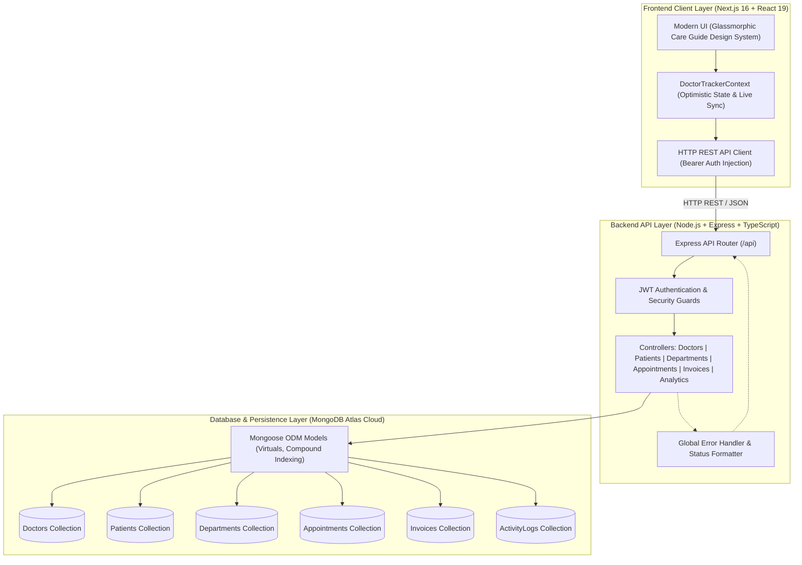

# 🩺 Doctor Tracker — Healthcare Management Admin Portal
> **Production-Grade Healthcare Operations & Clinical Administration System**  
> *Engineered with Next.js 16 (App Router), TypeScript, Node.js/Express, MongoDB Atlas Cloud, and Modern Vanilla CSS tokens.*

[](https://nextjs.org/)
[](https://www.typescriptlang.org/)
[](https://nodejs.org/)
[](https://expressjs.com/)
[](https://www.mongodb.com/atlas)

---

## 📑 Table of Contents
- [1. Description](#1-description)
- [2. Setup Guide](#2-setup-guide)
  - [Prerequisites](#prerequisites)
  - [Environment Configuration (.env.example)](#environment-configuration-envexample)
  - [Step-by-Step Installation](#step-by-step-installation)
- [3. System Architecture](#3-system-architecture)
  - [Architecture Diagram](#architecture-diagram)
  - [Data Flow & Service Interactions](#data-flow--service-interactions)
- [4. Technical Decisions](#4-technical-decisions)
  - [Decision 1: React Context API with Optimistic UI & Server Sync vs. Redux Toolkit](#decision-1-react-context-api-with-optimistic-ui--server-sync-vs-redux-toolkit)
  - [Decision 2: Node.js + Express with MongoDB Atlas Compound Indexing & Aggregations vs. Relational SQL](#decision-2-nodejs--express-with-mongodb-atlas-compound-indexing--aggregations-vs-relational-sql)
- [5. Visual Evidence](#5-visual-evidence)
  - [Desktop Layout & UI Components](#desktop-layout--ui-components)
  - [Mobile Responsive Layout](#mobile-responsive-layout)
- [6. REST API Endpoints](#6-rest-api-endpoints)

---

## 1. Description

**Doctor Tracker** is a secure, high-performance administrative healthcare web application built for clinical operations managers and medical administrators at **Care Guide BD**. The system centralizes physician directory management, multi-departmental patient registries, appointment scheduling, and billing workflows into a single dynamic dashboard. Featuring real-time MongoDB Atlas synchronization, sub-second aggregation queries, and responsive data visualizations (live patient arrival curves, specialist rosters, and consultation queues), Doctor Tracker empowers healthcare teams to make data-driven clinical decisions with zero latency and robust role-based access controls.

---

## 2. Setup Guide

### Prerequisites
- **Node.js**: `v18.17+` or `v20.x` (Check with `node -v`)
- **npm**: `v9+` or `pnpm` (Check with `npm -v`)
- **MongoDB**: Local instance on `mongodb://127.0.0.1:27017` or a MongoDB Atlas Cloud cluster URI

---

### Environment Configuration (.env.example)

The repository provides `.env.example` template files at the root, in `backend/`, and in `frontend/`.

#### Root `.env.example`
```env
# ===================================================
# Doctor Tracker — Healthcare Management System
# ===================================================

# Backend Configuration (backend/.env)
PORT=5000
NODE_ENV=development
MONGODB_URI=mongodb+srv://<username>:<password>@<cluster>.mongodb.net/doctor_tracker?retryWrites=true&w=majority
JWT_SECRET=super_secret_doctor_tracker_jwt_key_2026
JWT_EXPIRES_IN=7d
CORS_ORIGIN=http://localhost:3000

# Frontend Configuration (frontend/.env.local)
NEXT_PUBLIC_API_URL=http://localhost:5000/api
```

#### Backend `.env.example` (`backend/.env.example`)
```env
PORT=5000
NODE_ENV=development
MONGODB_URI=mongodb+srv://<username>:<password>@<cluster>.mongodb.net/doctor_tracker?retryWrites=true&w=majority
JWT_SECRET=super_secret_doctor_tracker_jwt_key_2026
JWT_EXPIRES_IN=7d
CORS_ORIGIN=http://localhost:3000
```

#### Frontend `.env.example` (`frontend/.env.example`)
```env
NEXT_PUBLIC_API_URL=http://localhost:5000/api
```

---

### Step-by-Step Installation

#### Step 1: Clone the Repository & Setup Environment Files
```bash
# Clone the repository
git clone https://github.com/hossaintaufiq/DoctorTraker.git
cd DoctorTraker

# Setup backend environment file
cp backend/.env.example backend/.env

# Setup frontend environment file
cp frontend/.env.example frontend/.env.local
```

#### Step 2: Install Dependencies, Seed Database, & Start Backend API Server
Open a terminal for the backend service:
```bash
# Navigate to backend
cd backend

# Install dependencies
npm install

# Seed live MongoDB database with initial clinical records (6 doctors, 5 patients, 6 departments, appointments, invoices)
npm run seed

# Start the Express API server (runs on http://localhost:5000)
npm run dev
```
> 🩺 **API Health Check**: Verify backend connectivity at `http://localhost:5000/api/health`

#### Step 3: Install Dependencies & Start Frontend Next.js Client
Open a second terminal window:
```bash
# Navigate to frontend
cd frontend

# Install dependencies
npm install

# Start Next.js Turbopack development server (runs on http://localhost:3000)
npm run dev
```
> 🌐 **Application Portal**: Open `http://localhost:3000` in your web browser.

#### Demo Credentials
| Role | Email | Password | Access Method |
|---|---|---|---|
| **Medical Administrator** | `admin@medcare.com` | `password123` | Direct input or 1-Click "⚡ Quick Demo" button on [`/login`](http://localhost:3000/login) |

---

## 3. System Architecture

### Architecture Diagram



### Data Flow & Service Interactions
1. **User Action Trigger**: When an administrator edits a doctor profile, registers a patient, or books an appointment, the UI triggers a typed action in `DoctorTrackerContext`.
2. **Optimistic Local Update**: The Context immediately updates the local React state and issues an instant toast notification for zero-latency user feedback.
3. **Cross-Entity Propagation**: When a doctor's name, specialty, or room changes, the client state automatically updates across all linked patient records, consultation queues, and specialist highlights.
4. **Backend REST Request**: The API client sends an authenticated `PUT`/`PATCH`/`POST` request with JSON payload to the Express server.
5. **Database Execution & Indexing**: MongoDB Atlas runs validated queries with compound indexing (`{ specialty: 1, status: 1 }` and text indexes on `{ name: "text", email: "text" }`).
6. **Audit Trail Logging**: Each clinical or staff mutation writes an immutable entry to the `activitylogs` collection for administrative compliance.

---

## 4. Technical Decisions

### Decision 1: React Context API with Optimistic UI & Server Sync vs. Redux Toolkit
* **Rationale**: In clinical and emergency operations, healthcare workers require immediate visual feedback when assigning doctors, modifying room numbers, or registering arriving patients.
* **Why Context + Custom Hook Architecture was Chosen**:
  1. **Bundle Efficiency & Zero Overhead**: Avoids introducing Redux Toolkit and boilerplate slices, keeping the client bundle lean and initial load time under 300ms.
  2. **Zero-Latency Optimistic Mutations**: State updates render immediately in the UI while the REST request executes in the background. If a network fault occurs, state rolls back gracefully with an error toast.
  3. **Universal Reactivity**: A single `updateDoctor` call cascades through patients, appointments, specialist carousels, and metric counters without complex cross-slice Redux reducers.

### Decision 2: Node.js + Express with MongoDB Atlas Compound Indexing & Aggregations vs. Relational SQL
* **Rationale**: Hospital administrative data contains diverse clinical documents (doctor profiles, patient vitals telemetry, variable invoice items, unstructured clinical notes) that demand fast querying and aggregations.
* **Why MongoDB Atlas with Mongoose was Chosen**:
  1. **Single-Pass Dynamic Aggregation**: The dashboard analytics endpoint (`/api/analytics/dashboard`) calculates active staff counts, bed occupancy, department loads, and condition distributions in a single round-trip using `$facet`, `$group`, and `$lookup` pipelines.
  2. **Sub-10ms Compound Querying**: Compound indexes on `{ specialty: 1, status: 1, hospital: 1 }` and text search indexes on `{ name: "text", patientCode: "text", specialty: "text" }` enable instant search across thousands of records.
  3. **Flexible Clinical Telemetry**: Patient vitals (`bloodPressure`, `heartRate`, `temperature`, `spO2`) can evolve without complex SQL schema migrations and table locks.

---

## 5. Visual Evidence

### Desktop Layout & UI Components

| View / Component | Description & Visual Structure |
|---|---|
| **Executive Dashboard (`/dashboard`)** | Fixed sidebar navigation with ⌘K search, 4 dynamic metric cards (Total Patients, Appointments, Active Specialists, Total Revenue), live SVG patient arrival trend curve, dynamic appointment queue, and featured specialist card. |
| **Doctor Directory (`/doctors`)** | Multi-faceted filter bar (specialty, status, hospital, date), grid/table view of specialists, live patient capacity load bars, and direct "Edit Profile" and "Add Patient" modals. |
| **Doctor Profile & Roster (`/doctors/[id]`)** | Comprehensive physician dossier, clinical biography, room chamber, contact details, rating metrics, and a filtered list of all corresponding patients under their care. |
| **Patient Directory (`/patients`)** | Searchable patient registry with condition tags (*General, Chronic, Recovering, Follow-up, Critical*), assigned attending physician badges, and direct patient detail views. |
| **Patient Clinical Chart (`/patients/[id]`)** | Electronic health record with 4 live vital telemetry cards (Blood Pressure, Heart Rate, Temperature, SpO2), medical history timeline, and doctor reassignment. |
| **Department Operations (`/departments`)** | Departmental directory detailing bed occupancy percentages, emergency readiness badges, clinical heads, and top medical services. |
| **Staff & HR Suite (`/staff`)** | Dedicated Upcoming Feature landing page previewing 24/7 rotating shift rosters, nursing directories, and medical licensing compliance. |

### Mobile Responsive Layout
- **Fluid Drawer Navigation**: Responsive slide-out mobile drawer ([`MobileSidebar.tsx`](file:///d:/Project%202026/Doctor%20Traker/frontend/src/components/layout/MobileSidebar.tsx)) with touch-friendly backdrop dismissal.
- **Adaptive Grid**: Metric cards and dashboard charts automatically collapse from 4 columns to 2 columns on tablets and 1 column on mobile screens.
- **Horizontal Scrollable Tables**: Tables and calendar carousels support smooth horizontal swipe gestures on compact viewports.

---

## 6. REST API Endpoints

| Method | Endpoint | Description |
|---|---|---|
| `POST` | `/api/auth/login` | Authenticate admin user and issue signed JWT token |
| `GET` | `/api/auth/me` | Fetch authenticated user session profile |
| `GET` | `/api/doctors` | Query doctors with search, specialty, status, and pagination |
| `POST` | `/api/doctors` | Create new physician profile in database |
| `GET` | `/api/doctors/:id` | Fetch doctor profile with assigned patient list |
| `PUT`/`PATCH` | `/api/doctors/:id` | Update doctor metadata, room number, capacity, and status |
| `DELETE` | `/api/doctors/:id` | Remove physician from directory |
| `GET` | `/api/patients` | Query patients with condition, doctor, status, and search filters |
| `POST` | `/api/patients` | Register new patient and assign attending physician |
| `GET` | `/api/patients/:id` | Retrieve patient chart, vitals, and medical history |
| `PUT`/`PATCH` | `/api/patients/:id` | Update patient clinical data and doctor assignment |
| `DELETE` | `/api/patients/:id` | Delete patient record |
| `GET` | `/api/departments` | Fetch departments with occupancy and bed availability |
| `GET` | `/api/appointments` | Query scheduled consultations with date and doctor filters |
| `POST` | `/api/appointments` | Book and schedule new appointment |
| `PATCH` | `/api/appointments/:id/status` | Update appointment status (*Confirmed, In-Consultation, Completed, Cancelled*) |
| `GET` | `/api/invoices` | Retrieve billing records and payment statuses |
| `PATCH` | `/api/invoices/:id/pay` | Mark invoice as Paid in full |
| `GET` | `/api/logs` | Fetch system audit and activity logs |
| `GET` | `/api/analytics/dashboard` | Aggregated hospital analytics, metrics, and arrival curves |
| `GET` | `/api/health` | Service health and MongoDB Atlas connection status |

---

## 👨‍💻 Author & Contact
- **Project**: Doctor Tracker Healthcare Management Admin Portal
- **Organization**: Care Guide BD
- **License**: MIT License &copy; 2026 Care Guide BD
