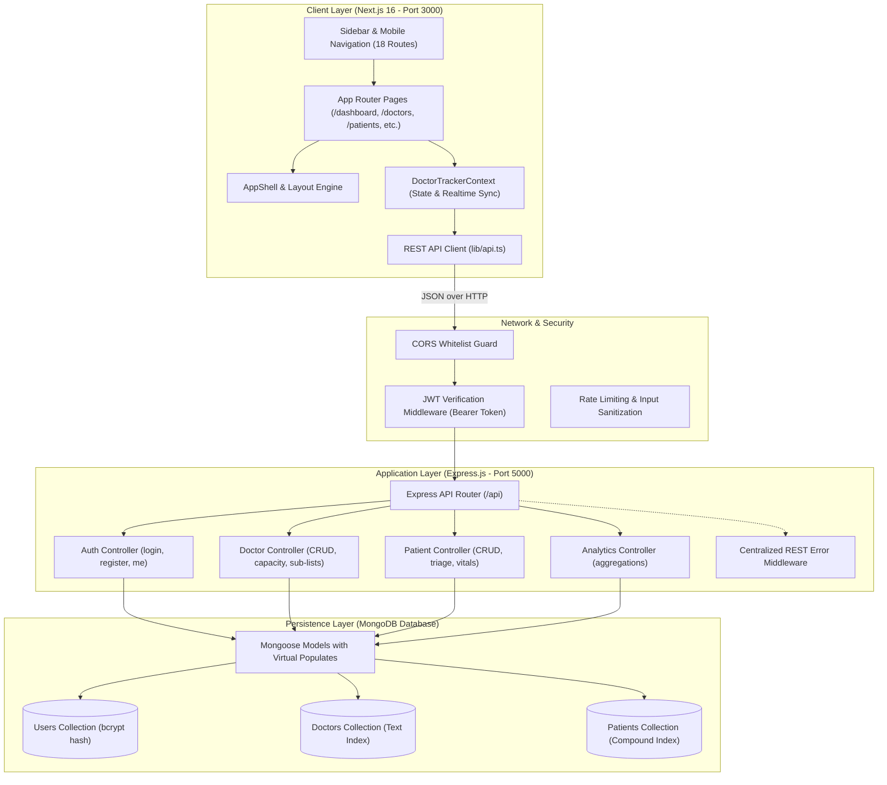
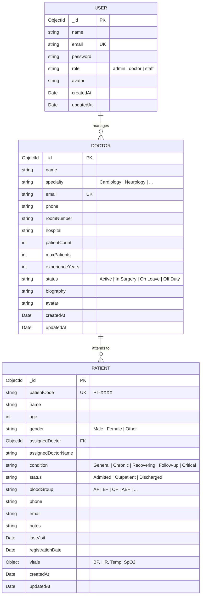

# 🏛️ System Architecture Document (SAD)
## Project: Doctor Tracker — Healthcare Management Admin Portal
**System Type:** Decoupled Full-Stack Web Application (SPA/SSR Client + Standalone REST Backend + NoSQL Database)  
**Author:** Lead Software Architect  
**Version:** 1.0.0  

---

## 1. High-Level Architecture Overview

Doctor Tracker follows a **decoupled 3-tier architecture**:
1. **Presentation Tier (Frontend Client)**: Built with Next.js 16 (React 19, TypeScript, Tailwind CSS v4) utilizing App Router architecture with client-side reactive caching and optimistic state mutation.
2. **Application Tier (Backend API Server)**: Standalone Node.js + Express REST API server providing stateless authentication, controller business logic, input validation, and centralized error logging.
3. **Data Tier (Database Layer)**: MongoDB document store accessed through Mongoose 8.x with compound text indexing and aggregation pipelines.

---

## 2. Architecture & Data Flow Diagram



---

## 3. Component Architecture Breakdown

### 3.1 Frontend Component Hierarchy
```
frontend/src/
├── app/
│   ├── layout.tsx                # Root layout with ToastContainer & DoctorTrackerProvider
│   ├── globals.css               # Design tokens (@layer theme, components, utilities)
│   ├── page.tsx                  # Dashboard redirect and homepage
│   ├── dashboard/page.tsx        # Main analytics & clinical control center
│   ├── doctors/
│   │   ├── page.tsx              # Doctor directory, search, specialty filters
│   │   └── [id]/page.tsx         # Doctor chart & assigned patient sub-list
│   ├── patients/
│   │   ├── page.tsx              # Patient directory, triage filters, CSV exporter
│   │   └── [id]/page.tsx         # Patient chart, vitals summary, clinical notes
│   ├── appointments/page.tsx     # Calendar agenda & booking matrix
│   ├── departments/page.tsx      # Departmental loads & division chiefs
│   ├── analytics/page.tsx        # Departmental admissions & revenue telemetry
│   ├── billing/page.tsx          # Claims, invoices, payment trackers
│   ├── staff/page.tsx            # Nursing & technical staff duty roster
│   ├── pharmacy/page.tsx         # Medicine inventory & stock telemetry
│   ├── emergency/page.tsx        # ER triage & admission tracking
│   ├── payment/page.tsx          # Collections, transaction breakdown
│   ├── settings/page.tsx         # Hospital organization preferences
│   ├── admin/page.tsx            # Access control, audit logs, backup
│   └── login/page.tsx            # Secure portal authentication
├── components/
│   ├── layout/
│   │   ├── AppShell.tsx          # Core wrapper with sidebar + top navbar
│   │   ├── Sidebar.tsx           # Sticky desktop sidebar with active highlights
│   │   ├── MobileSidebar.tsx     # Mobile slide-out drawer
│   │   └── TopNavbar.tsx         # Wide pill search, theme toggle, profile
│   ├── dashboard/
│   │   ├── DashboardHeader.tsx   # Title, CSV export, Report modal trigger, Time pill
│   │   ├── MetricCardsGrid.tsx   # 4 clinical summary metric cards
│   │   ├── PatientArrivalChart.tsx # Dual hatched SVG arrival curve
│   │   ├── OurSpecialistCard.tsx # Featured doctor hero card + roster
│   │   └── AppointmentsSection.tsx # 23-day carousel strip & table
│   └── modals/
│       ├── AddDoctorModal.tsx    # Doctor registration with validation
│       ├── AddPatientModal.tsx   # Patient registration with doctor assignment
│       └── ReportModal.tsx       # Interactive operational summary preview & print
└── context/
    └── DoctorTrackerContext.tsx  # Optimistic mutations & background sync
```

---

## 4. Database Schema & ERD



---

## 5. Security & Data Protection Design

1. **Authentication**: Stateless JSON Web Tokens (JWT) signed with HMAC SHA-256 and verified on every protected request.
2. **Password Security**: Cryptographic hashing via `bcryptjs` with adaptive work factor (salt rounds: 10).
3. **Data Encapsulation**: Passwords excluded by default on user retrieval (`select: false`).
4. **CORS Protocol**: Origin validation strictly permits authorized frontend origins (`http://localhost:3000`).
5. **Input Validation**: Mongoose schema validations sanitize data types, enforce string trims, and validate email formats.
