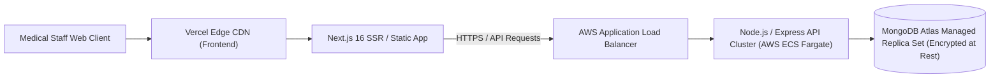

# 🚢 Deployment, DevOps & Production Readiness Guide
## Project: Doctor Tracker — Healthcare Management Admin Portal
**Deployment Architecture:** Containerized Microservices / Vercel + AWS ECS + MongoDB Atlas  

---

## 1. Production Deployment Topology



---

## 2. Docker Containerization

### 2.1 Backend Dockerfile (`backend/Dockerfile`)
```dockerfile
# Build Stage
FROM node:20-alpine AS builder
WORKDIR /app
COPY package*.json ./
RUN npm ci
COPY . .
RUN npm run build

# Production Stage
FROM node:20-alpine AS runner
WORKDIR /app
ENV NODE_ENV=production
COPY package*.json ./
RUN npm ci --only=production
COPY --from=builder /app/dist ./dist
EXPOSE 5000
CMD ["node", "dist/server.js"]
```

### 2.2 Frontend Dockerfile (`frontend/Dockerfile`)
```dockerfile
FROM node:20-alpine AS builder
WORKDIR /app
COPY package*.json ./
RUN npm ci
COPY . .
RUN npm run build

FROM node:20-alpine AS runner
WORKDIR /app
ENV NODE_ENV=production
COPY --from=builder /app/.next/standalone ./
COPY --from=builder /app/public ./public
COPY --from=builder /app/.next/static ./.next/static
EXPOSE 3000
CMD ["node", "server.js"]
```

---

## 3. CI/CD GitHub Actions Workflow

```yaml
name: Doctor Tracker CI/CD Pipeline

on:
  push:
    branches: [main]
  pull_request:
    branches: [main]

jobs:
  test-and-build:
    runs-on: ubuntu-latest
    steps:
      - uses: actions/checkout@v4
      - name: Setup Node.js
        uses: actions/setup-node@v4
        with:
          node-version: 20
          cache: 'npm'

      - name: Test & Build Backend
        run: |
          cd backend
          npm ci
          npm run build

      - name: Test & Build Frontend
        run: |
          cd frontend
          npm ci
          npm run build
```

---

## 4. Production Security Checklist
- [x] Enforce TLS 1.3 for all HTTP traffic.
- [x] Configure strict CORS headers restricting client requests to the registered domain.
- [x] Enable MongoDB encryption at rest (AES-256) and TLS connection strings (`mongodb+srv://`).
- [x] Store JWT secrets in cloud secret managers (AWS Secrets Manager / Vault).
- [x] Set automated database snapshots every 6 hours with 30-day retention.
